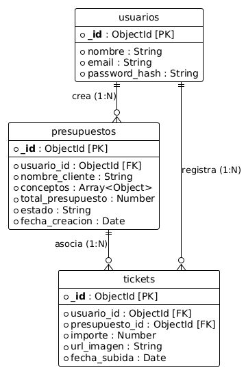
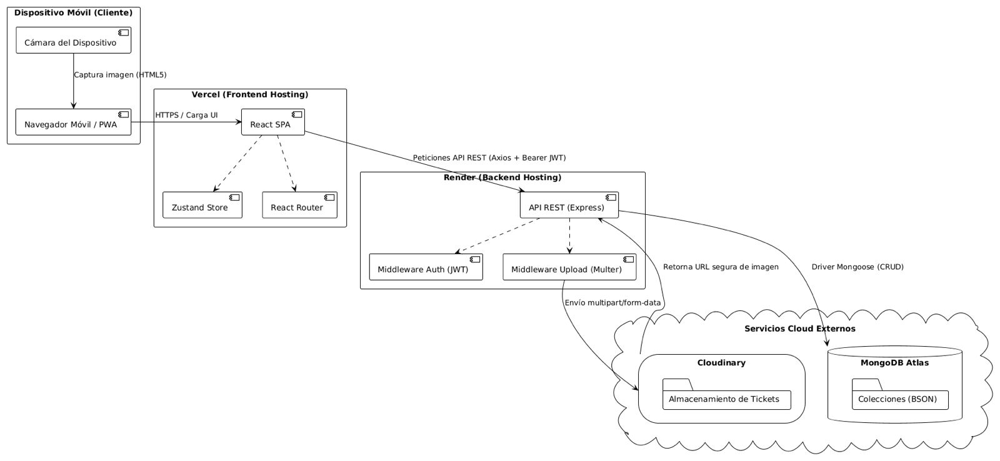

# Viabilidad Técnica · Equipo 1

## Introducción
Este documento evalúa la viabilidad técnica para la construcción de «Gestor de Negocios», una solución web pensada para el teléfono móvil y orientada a profesionales de oficios en movilidad. El Producto Mínimo Viable (MVP) cubre la creación inmediata de presupuestos in situ, su envío directo al cliente por WhatsApp mediante un enlace temporal y la captura fotográfica de tickets de compra vinculados al trabajo. Se adopta un stack MERN (MongoDB Atlas, Express, React con Vite y Node.js), estilado con CSS nativo (CSS Modules y Variables CSS) sin frameworks externos, y gestionado en cliente mediante Zustand. El proyecto resulta plenamente viable en los plazos previstos, identificándose como principal riesgo la latencia por el arranque en frío de Render en su capa gratuita, mitigada mediante una precarga preventiva en segundo plano.

## 1. Análisis de Requisitos Funcionales y Priorización (MoSCoW)

### Must have
1. Registrar un nuevo usuario (autónomo/técnico) en el sistema.
2. Iniciar sesión en la aplicación web desde el móvil con credenciales seguras.
3. Crear un presupuesto añadiendo datos del cliente y líneas de concepto rápidas (ej. “Mano de obra”, “Material”).
4. Generar un enlace público temporal con caducidad para compartir un presupuesto.
5. Redirigir automáticamente a la app nativa de WhatsApp con un mensaje predefinido que incluya el enlace temporal del presupuesto.
6. Subir una fotografía desde la cámara del navegador móvil de un ticket de compra.
7. Asociar la fotografía de un ticket a un presupuesto/trabajo en curso.

### Should have
8. Aceptar o rechazar un presupuesto desde el enlace público temporal (vista del cliente).
9. Listar el histórico de presupuestos con su estado (pendientes, aceptados, rechazados).
10. Listar los gastos acumulados a partir de los tickets fotografiados en un mes.

### Could have
11. Calcular el beneficio neto de un trabajo restando los tickets asociados al total presupuestado.
12. Descargar un presupuesto aceptado en formato PDF.

### Won't have
13. Integrar con cuentas bancarias para la conciliación de pagos.
14. Gestionar el inventario y stock físico de los materiales del almacén.

## 2. Producto Mínimo Viable (MVP)

El MVP se compone estrictamente de los 7 requisitos funcionales catalogados como **Must have**. Todo lo demás queda fuera de esta primera iteración.

### Recorrido mínimo del usuario:
- **Acceso:** Abre la aplicación web en el navegador del teléfono móvil e inicia sesión con su cuenta.
- **Creación:** Tras diagnosticar una avería in situ, crea un nuevo presupuesto introduciendo los datos del cliente y seleccionando líneas de gasto básicas mediante iconos rápidos (material y mano de obra).
- **Envío:** Genera un enlace público temporal con fecha de caducidad y la aplicación web lo redirige a la app de WhatsApp con un mensaje preparado para el cliente con dicho enlace.
- **Registro de gasto:** Al salir hacia el almacén de suministros, pulsa el botón de captura rápida y fotografía el ticket físico de papel usando la cámara del navegador móvil.
- **Asociación:** Asocia esa fotografía al presupuesto recién emitido, dejando el gasto registrado y archivado en la nube sin necesidad de ordenador de escritorio.

## 3. Requisitos Técnicos: Frontend, Backend e Infraestructura

### 3.1 Frontend (React)
La aplicación será una web pensada para el móvil (*mobile-first*), con botones grandes y concebida para teclear lo mínimo. Existirán dos vistas: la del técnico autenticado y la del cliente (acceso público temporal sin registro). Se utilizará Vite para compilar el proyecto de React, junto con las siguientes herramientas:

- **Navegación (React Router):** Gestión de rutas SPA (`/login`, `/panel`, `/nuevo-presupuesto`) y la ruta pública parametrizada (`/p/:token`), que es la que abre el cliente desde WhatsApp.
- **Gestión del estado (Zustand):** Se unifica la gestión del estado global en Zustand por su ligereza y simplicidad frente a Redux o Context, manteniendo el usuario con sesión activa y el borrador del presupuesto mientras se navega entre pantallas.
- **Estilos y componentes de interfaz (CSS nativo + lucide-react):** Se descarta cualquier framework CSS externo (como Tailwind CSS, Bootstrap o MUI) para evitar sobrecarga de dependencias y garantizar un rendimiento óptimo en pantallas táctiles de gama baja. Se utilizará CSS nativo mediante variables CSS (`:root`) para temas/paleta y CSS Modules para encapsular estilos por componente. `lucide-react` aportará los iconos táctiles de los conceptos (material, mano de obra, desplazamiento).
- **Peticiones al backend (Axios):** Cliente HTTP para comunicar con la API de Express, configurando la URL base y enviando el token JWT en las cabeceras de autorización de forma automática.
- **Formularios (React Hook Form):** Control y validación ligera en formularios de login y registro.
- **Sin biblioteca:** La foto del ticket se invoca con `<input type="file" capture="environment">`, que abre la cámara del teléfono móvil de forma estándar, y el envío se realiza mediante la API de enlaces de WhatsApp (`wa.me/?text=...`).

### 3.2 Backend (Node.js + Express)
El servidor expondrá una API REST consumida por el frontend mediante Axios:
- **Autenticación y Seguridad (JWT + bcrypt):** Arquitectura *stateless* mediante tokens JWT (*JSON Web Tokens*). El servidor valida los tokens en cada petición protegida. Las contraseñas se almacenan con hash salt mediante **bcrypt**.
- **Permisos y Roles:**
  - *Técnico (Autenticado):* Requiere JWT válido. Permite crear presupuestos, subir tickets y consultarlos.
  - *Cliente (Invitado):* Ruta pública que valida el parámetro `token_acceso` en la URL. Permite consultar el presupuesto asociado y cambiar su estado a "Aceptado" o "Rechazado" siempre que no haya expirado.
- **Gestión de Ficheros (Multer):** Middleware para procesar las peticiones `multipart/form-data` enviadas desde el `<input type="file">` del frontend móvil.
- **Servicios Externos (Cloudinary):** Al ser efímero el sistema de archivos de Render, el backend delega el alojamiento de las imágenes a la API de Cloudinary. El plan gratuito incluye 25 créditos mensuales (1 crédito = 1.000 transformaciones o 1 GB de almacenamiento), suficiente para el MVP.

### 3.3 Base de Datos (MongoDB Atlas)
Esquema de colecciones preliminares adaptado a los requisitos funcionales:

**1. Colección `usuarios`**
- `_id`: ObjectId
- `email`: String (único)
- `password_hash`: String (encriptada con bcrypt)
- `nombre_fiscal`: String (nombre visible para el cliente en el presupuesto)
- `telefono`: String (teléfono de contacto comercial del técnico)

**2. Colección `presupuestos`**
- `_id`: ObjectId
- `usuario_id`: ObjectId (referencia al autor en `usuarios`)
- `cliente_nombre`: String (nombre del cliente receptor)
- `cliente_telefono`: String (teléfono de contacto del cliente)
- `conceptos`: Array de objetos `[{ descripcion: String, precio: Number }]`
- `total_presupuesto`: Number
- `estado`: String (Enum: `['Pendiente', 'Aceptado', 'Rechazado']`)
- `token_acceso`: String (UUID criptográfico para acceso público sin login)
- `expira_en`: Date (fecha de caducidad del enlace temporal)
- `fecha_creacion`: Date

**3. Colección `tickets`**
- `_id`: ObjectId
- `usuario_id`: ObjectId (referencia a `usuarios`)
- `presupuesto_id`: ObjectId (referencia a `presupuestos` para asociarlo al trabajo)
- `importe`: Number
- `url_imagen`: String (URL segura devuelta por Cloudinary)
- `fecha_subida`: Date

### 3.4 Infraestructura
- **Frontend (Vercel):** Despliegue continuo vinculado al repositorio de GitHub en su plan Hobby, con soporte HTTPS nativo y CDN global.
- **Backend (Render):** Web Service gratuito ejecutando Node.js con 750 horas mensuales.
- **Base de Datos (MongoDB Atlas):** Clúster M0 Sandbox (512 MB de almacenamiento y 500 conexiones concurrentes).
- **Almacenamiento multimedia (Cloudinary):** Capa gratuita para persistencia de imágenes fotográficas.
- **Mitigación del arranque en Render:** Debido a que Render suspende los servicios tras 15 minutos de inactividad, la aplicación web realizará una petición asíncrona de comprobación de salud (*health check*) nada más abrirse. Mientras el servidor arranca, la interfaz mostrará una barra con el mensaje *"Preparando tu presupuesto..."* para evitar sensación de bloqueo.

## 4. Evaluación de Capacidades del Equipo

### 4.1 Inventario de habilidades (Persona × Tecnología)

| Persona | HTML/CSS | JavaScript/React | Node.js/Express | MongoDB | Git/DevOps | Diseño UX |
| :--- | :--- | :--- | :--- | :--- | :--- | :--- |
| **Dylan Bauti Huelva** | Avanzado | Intermedio | Básico | Intermedio | Intermedio | Básico |
| **Rocío Luque Montes** | Avanzado | Avanzado | Intermedio | Intermedio | Intermedio | Avanzado |
| **Manuel Amado Rodríguez** | Intermedio | Intermedio | Intermedio | Intermedio | Intermedio | Básico |
| **José Luis Yuani Barea** | Intermedio | Básico | Básico | Básico | Básico | Intermedio |

### 4.2 Lagunas de conocimiento
- **Captura y subida de imágenes (Multer + Cloudinary):** Procesamiento de `multipart/form-data` y delegación a Cloudinary desde el backend.
- **Autenticación con JWT:** Implementación de middlewares en Express y gestión segura de tokens en cliente.
- **Gestión de estado global con Zustand:** Manejo del almacén de datos del presupuesto sin recurrir a Context o Redux.
- **Despliegues en Render y Vercel:** Configuración de variables de entorno seguras, políticas de CORS y conexión con MongoDB Atlas en producción.

### 4.3 Viabilidad temporal
Con la incorporación del cuarto integrante focalizado en backend y apoyo técnico, el alcance acotado a los 7 requisitos *Must have* es viable. Al descartar la integración bancaria y la generación de PDF para esta primera entrega, el núcleo del sistema es un CRUD adaptado a pantallas móviles abordable dentro de las semanas asignadas.

## 5. Identificación de Riesgos Técnicos

| ID | Riesgo | Probabilidad / Impacto | Mitigación preventiva |
| :--- | :--- | :--- | :--- |
| **R-01** | Bloqueo en la implementación de subida de fotos (Cámara -> Express -> Cloudinary). | Media / Alto | Elaborar en la primera semana una prueba de concepto aislada (PoC) en un script básico antes de acoplarlo a la aplicación principal. |
| **R-02** | Pérdida de código o conflictos graves al integrar cambios (*Merge Conflicts*). | Alta / Alto | Flujo estricto de ramas (`develop` y ramas de tarea). Bloqueo de commits directos y exigencia de PR con al menos una revisión aprobada (*Approve*). |
| **R-03** | Errores de CORS o fallos en variables de entorno detectados tarde en producción. | Media / Alto | Despliegue de un "Hola Mundo" completo conectando Vercel, Render y MongoDB Atlas durante los primeros días de desarrollo. |
| **R-04** | Latencia excesiva o sensación de app colgada por el arranque en frío de Render. | Alta / Medio | Petición ligera en segundo plano al cargar la web junto con un indicador visual explicativo ("Preparando tu presupuesto..."). |
| **R-05** | Falta de tiempo al final de la iteración para terminar las funcionalidades. | Media / Crítico | Priorización estricta del MVP: congelar cualquier funcionalidad *Should* o *Could* hasta que los 7 requisitos *Must have* estén 100% operativos. |
